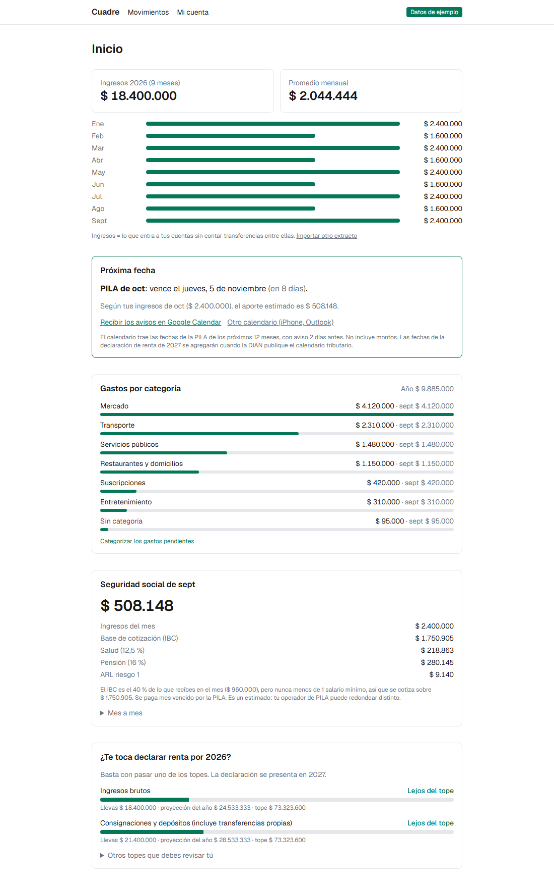
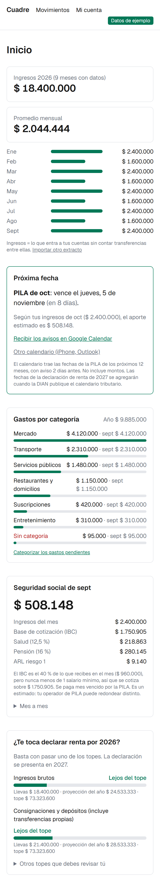
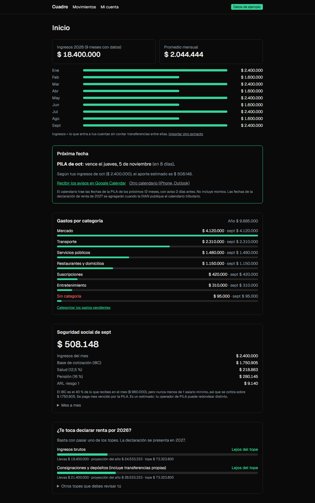

# Cuadre

[](https://github.com/sebasrh7/cuadre/actions/workflows/ci.yml)

**Las finanzas de un independiente en Colombia, cuadradas.** Importas el extracto de Bancolombia y Cuadre te dice cuánto recibes al mes, en qué gastas, cuánto te toca aportar a seguridad social, cuándo vence tu PILA y si vas a tener que declarar renta.

**Demo:** [cuadre-kohl-eight.vercel.app](https://cuadre-kohl-eight.vercel.app) (entrar con Google)



<p>
  
  
</p>

*Capturas con datos inventados (`/demo`, solo en desarrollo).*

## Qué hace

| | |
|---|---|
| **Importa el extracto** | Lee el PDF de Bancolombia **en el navegador** con pdf.js: el archivo y su contraseña nunca salen del equipo. Verifica que el extracto cuadre (resumen, totales y saldo de cada movimiento) antes de guardar nada. Reimportar no duplica. |
| **Separa lo que es tuyo** | Detecta transferencias entre tus propias cuentas (Nequi, tu nombre aunque el banco lo corte a 12 letras) para que no cuenten como ingreso ni gasto. |
| **Categoriza gastos** | Reglas para comercios conocidos + **Gemini** (opcional) para el resto, con salida JSON validada con Zod, caché por comercio, cupo diario y correcciones del usuario que siempre ganan. Sin IA también funciona. |
| **Seguridad social** | IBC (40 % del ingreso, piso 1 SMMLV, techo 25), salud, pensión y ARL mes a mes, con la fórmula visible. |
| **¿Me toca declarar renta?** | Ingresos y consignaciones contra el tope en UVT, con proyección a fin de año. |
| **Recordatorios** | Próxima fecha de la PILA (según los dos últimos dígitos de la cédula, días hábiles y festivos) y un calendario `.ics` para suscribirse desde Google Calendar. |
| **Tus datos son tuyos** | Política de tratamiento de datos (Ley 1581), autorización expresa, exportar a Excel/JSON y borrar la cuenta con todo en cascada. |

## Decisiones de diseño

- **Privacidad primero.** Solo se guardan los últimos 4 dígitos de cuentas y tarjetas. A la IA solo llegan nombres de comercio: los pagos a personas se filtran antes. Todas las tablas tienen Row Level Security.
- **Dinero en enteros.** Pesos sin decimales y centavos donde hace falta; los intereses diarios se suman en centavos antes de redondear.
- **Ninguna regla fiscal en el código.** UVT, salario mínimo, topes de renta, tarifas y plazos de la PILA viven en la base de datos, cada valor con su norma y la URL de la fuente donde se verificó.
- **La IA es opcional.** Apagada por defecto; si no hay cupo o falla, los gastos quedan pendientes, nunca inventados.
- **Costo $0.** Planes gratuitos de Vercel, Supabase y Gemini.

## Stack

Next.js 16 (App Router, Server Actions, Cache Components) · React 19 · TypeScript estricto · Tailwind CSS 4 · Supabase (Postgres, Auth, RLS) · Zod · pdf.js · Gemini · Vitest · Playwright · GitHub Actions · Vercel

## Estructura

```
src/
  app/                      Rutas (inicio, importar, movimientos, cuenta, privacidad, calendario .ics)
  lib/parsers/              Lectores puros del extracto y de las alertas de Bancolombia
  lib/movements/            Clasificación, transferencias propias, plan de importación, conciliación
  lib/categories/           Reglas, orquestación con caché/cupo y proveedor de Gemini
  lib/tax/                  Seguridad social y renta a partir de tax_rules
  lib/dates/                Festivos (Ley 51 de 1983), días hábiles, PILA, iCalendar
supabase/migrations/        Esquema, RLS, funciones y reglas fiscales con su fuente
docs/ALCANCE.md             Alcance, decisiones y plan
```

## Desarrollo

Requiere Node 22.13+.

```bash
npm install
cp .env.example .env.local   # llaves de Supabase; GEMINI_API_KEY es opcional
npm run dev
```

| Comando | Qué hace |
|---|---|
| `npm test` | Tests unitarios (Vitest) |
| `npm run e2e` | Tests de punta a punta (Playwright) contra Supabase local: requiere Docker y `npx supabase start` |
| `npm run typecheck` | Tipos de rutas de Next + `tsc` |
| `npm run lint` | ESLint |
| `npm run db:push` | Aplica las migraciones al proyecto de Supabase enlazado |
| `npm run db:config` | Sube `supabase/config.toml` leyendo los secretos de `.env.local` |
| `npm run db:types` | Regenera los tipos de la base de datos |

GitHub Actions corre lint, tipos, tests unitarios y build en cada push, y en otro job levanta un Supabase local con todas las migraciones para correr los tests de punta a punta (onboarding, importar un extracto sintético, reimportar sin duplicar, exportar y borrar la cuenta).

## Aviso

Cuadre es una herramienta de apoyo, no asesoría contable ni tributaria.
